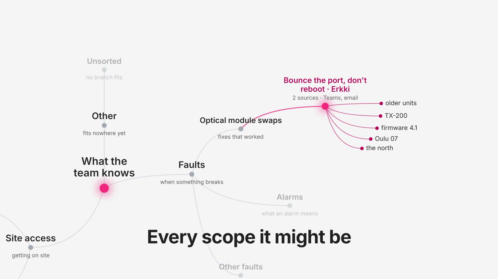

# Elisa hidden-knowledge context layer

Veikko swaps an optical module, the link comes up, the alarms clear, and traffic is still dead. Erkki knows the fix: bounce the interface, do not reboot. He has known it for years, and it is written down nowhere. Every time he is away, the team starts from zero.

This is a context layer for that knowledge. It reads the conversations people already have (a Teams thread, an email), stores each reusable operational rule as a **context assertion** bound to the network graph (a trigger, candidate scopes over topology attributes, an action, an avoid list, verbatim evidence, trust, validity), and hands it back when the same situation comes up on another unit. When nobody said exactly which units a tip applies to, it stores every reading, lets later cases narrow them, and asks the expert one question, once. It is advisory: it never acts on the network, never writes to the topology, and uses no numeric confidence anywhere.

Team: Mikael Salomaa and Abhishek, Since AI 2026.

## The demo video

[](video/elisa_demo.mp4)

**[Watch the demo video (2:03, mp4)](video/elisa_demo.mp4)**, or open `video/elisa_demo.mp4` from a clone. The script, what each scene draws on, and the numbers screen checked against the repo are in `docs/VIDEO.md`; the HyperFrames project that renders it is in `video/`. The Teams and tree scenes are animated rebuilds of the two front-ends below, with every line taken from `out/`. The video shows the solution working; this file and the code carry the technical decisions.

## See it in five minutes

```powershell
py -3.14 -m pip install -r requirements.txt
$env:LLM_OFFLINE="1"; py -3.14 -m pytest -q          # 467 tests, from the cached model calls, no cloud access needed
$env:LLM_OFFLINE="1"; py -3.14 -m eval.runner         # every scenario in data/scenarios, writes docs/CASE_TABLE.md
$env:LLM_OFFLINE="1"; py -3.14 demo.py                # the nine demo beats, writes out/
```

**Hosted, no install:** the Teams clone at [cbr-teams.vercel.app](https://cbr-teams.vercel.app/?beat=3) (`?beat=1` to `9`, `&channel=experts`, `&reveal=1` to reveal messages one by one) and the context map and tree at [cbr-map.vercel.app](https://cbr-map.vercel.app/tree?from=14&to=28&play=1). Both are the replay mode below, deployed from this repo with the Vercel CLI; live mode needs the API and runs locally.

Then either front-end, each on its own byte-for-byte copy of `out/`:

| Folder | What it shows | Run |
|---|---|---|
| `ui/` | A Microsoft Teams clone: the chats where the knowledge is captured, the one question, the relayed fix, the declines, the expiry, the retraction. `?beat=N` (1..9), `&channel=experts\|faults\|site-access`, `&reveal=1` to reveal messages one by one. | `cd ui; npm install; npm run dev` |
| `frontend-ui/` | The context map: the tip landing in the network graph with its candidate scopes, tip counts per region on a Finland map, and `/tree`, the context tree growing event by event as conversations are read. | `cd frontend-ui; npm install; npm run dev` |

Live mode (report a new fault, answer the question in the chat) runs the same front-ends against the API: `docs/DEMO.md`. The nine beats, what each proves, and the recording controls are there too.

## How it works

Four stages, all deterministic except the one model call in the first.

1. **Capture.** `adapters/` turn a Teams export or an email into messages. `extractor/extract.py` makes one structured Gemini call that returns the rule: trigger (event and symptoms), action, avoid list, the speaker, the verbatim excerpt, any stated condition ("older units"), and whether the speaker is retracting earlier advice. The excerpt is checked against the thread in code; if it is not there verbatim, it is dropped.
2. **Bind.** `binder/` resolves the entity the thread is about in the topology (`data/topology.json`), records the origin case and builds the **candidate scopes**: every reading of the stated condition as a predicate over topology attributes (model, firmware, site, region, install year, with an open edge where no number was given). `extractor/trust.py` derives trust from the evidence; `extractor/merge.py` folds the rule into an existing assertion with the same key or adds a new one; `store/` keeps the assertions and exports the graph.
3. **Recall.** `agent/get_context.py` is the one tool the operations agent calls for an incident. Per assertion it checks the trigger, validity at the incident time, scope and trust, then precedence between disputed rules, and returns `proposed`, `declined` (with the failing candidate or reason) or `ambiguous`. On `ambiguous`, `agent/questions.py` builds one question for the owning team, keyed on the ambiguity so it is never asked twice; the answer becomes the decided scope. `agent/stand_in.py` turns the results into the proposal text and `agent/notify.py` tells the expert their tip was used.
4. **Stay true.** A newer value for the same key supersedes the old one (`extractor/supersede.py`); a stated end date becomes `valid_to` (`binder/expiry.py`); a retraction sends the assertion to review (`extractor/retract.py`); recorded outcomes re-derive trust (`agent/outcomes.py`).

## Design decisions

Each row is one choice a judge can check: the reason, where it lives, and what proves it.

| Decision | Why | Code | Proof |
|---|---|---|---|
| **Silence when nothing is captured**, plus an explicit `prior_knowledge: "none"` signal | Wrong context is worse than none (Elisa confirmed this). The layer never invents a procedure; the agent's own runbook is its fallback. | `agent/stand_in.py` (`NO_CONTEXT`), `api/app.py` | beat 1; `tests/test_agent.py` |
| **Candidate scopes instead of one guess** | "Older units" could mean the model, the firmware, the site, the region or the year. All readings are stored; later cases vote them out (candidate elimination). The leaf is never picked by the model. | `binder/bind.py`, `extractor/vote.py` | beat 2 (five candidates), beat 3 (one left); `tests/test_binder.py` |
| **Open edge, no invented cutoff** | "Older" has no number. A comparison beyond the known edge evaluates to `unknown`, which asks, never to `holds`. The number is set only by the expert's answer. | `predicates/evaluate.py` (`open_edge_result`), `binder/condition.py` | beats 3 and 4; `tests/test_open_edge.py`, `tests/test_condition.py` |
| **One question, once, to the owning team** | The expert's time is the scarce resource. A question is keyed on the ambiguity, not the incident; the second technician gets the answer without anyone being asked again. | `agent/questions.py` | beat 3 asks, beat 7 does not; `tests/test_agent.py` |
| **Deduplicate by meaning, not wording** | Erkki's chat and email become one assertion with two sources; another engineer's "shut, no shut" on another model is a second case on the same key. Exact keys, no fuzzy matching, no model call. | `extractor/merge.py` | beat 2; eval scenario `07_reworded_other_model`; `tests/test_extractor.py` |
| **Verbatim evidence or nothing** | An excerpt the model returns that is not in the thread is dropped and the outcome falls back to `unknown`. The store never holds a sentence nobody wrote. | `extractor/extract.py` | `tests/test_extractor.py`; `docs/break/A_extractor.md` |
| **The model reads, the code decides** | Gemini returns a structured rule and nothing else. Scope, trust, outcome, supersession, expiry, the question, its options and the proposal wording are code, tested without a model. | `agent/get_context.py`, `contracts/get_context.md` | the whole suite runs with `LLM_OFFLINE=1` |
| **Facts expire on the date the engineer gave** | "Until 20 Nov" becomes `valid_to`; a dispatch after that date is declined "expired" with no human action. | `binder/expiry.py` | beat 8; `tests/test_expiry.py` |
| **Newer facts supersede, retractions go to review** | A new value for the same key closes the old one's validity and links the two; an expert taking a tip back puts it under review. Nothing is deleted. | `extractor/supersede.py`, `extractor/retract.py` | beats 6 and 9; `tests/test_supersede.py`, `tests/test_retract.py` |
| **No numeric confidence** | Trust is a closed vocabulary derived from the evidence (`contracts/vocabulary.md`) plus a case count. A percentage nobody can audit would be a guess dressed up. | `extractor/trust.py` | `tests/test_trust.py` |
| **Advisory only** | Every result carries its reason; nothing writes to the topology or acts on the network. | `agent/get_context.py` | `contracts/get_context.md` |
| **Break it before polishing it** | 49 adversarial cases aimed at the extractor and the rules, 24 fixes, before any front-end work. | `tests/break/` | `docs/BREAK_TESTS.md`, `docs/break/` |

Decisions taken during the build, with dates and reasons, are in `docs/DECISIONS.md`.

## Where generative AI is used, and where it is not

Gemini on Google Cloud Vertex AI (location `global`, Application Default Credentials, no API key). All calls go through `llm.py`, are cached on disk in `.llm_cache/` (keyed by model, prompt and schema) so the demo and tests replay offline, and are capped by `LLM_BUDGET_EUR` (spend recorded in `.llm_cache/_spend.json`).

| Model ID | model_version (from the response) | Used for |
|---|---|---|
| `gemini-4-argon` | `gemini-4-argon` | extractor: reads a thread and returns the structured rule. Stand-in operations agent: one structured call that turns `get_context` results into a proposal (`EXTRACT_MODEL`) |
| `gemini-3.5-flash` | `gemini-3.5-flash` | synthetic scenario threads from scripts, a different model on purpose (`GENERATE_MODEL`, see `data/DATA_CARD.md`) |

The model never decides scope, outcome, trust, supersession, expiry, or whether a question is asked. The code was written with Claude Code agents, one per module, each gated by its tests (`docs/process/`).

- `LLM_OFFLINE=1`: every model call must be a cache hit; a miss raises instead of calling Vertex AI.
- `OUT_DIR` overrides `out/`. Live calls need `GOOGLE_CLOUD_PROJECT` and Application Default Credentials.

## Repository map

| Path | What it is |
|---|---|
| `contracts/` | The frozen contracts: `message`, `topology` and `assertion` JSON schemas, the closed vocabulary, the predicate rules (`predicates.md`), the `get_context` contract, and the pydantic models the schemas are generated from |
| `adapters/` | Teams JSON and email text to messages |
| `extractor/` | The extraction call and evidence check, merge, vote, trust, supersede, retract |
| `binder/` | Entity resolution, candidate scopes, stated conditions, expiry dates |
| `predicates/` | Scope predicates over topology attributes, `holds`/`fails`/`unknown`/`missing`, the open edge |
| `agent/` | `get_context`, questions and answers, the stand-in agent, notifications, outcomes |
| `store/` | JSON store (primary), graph export; a Neo4j store is written but untested |
| `api/` | FastAPI: `GET /assertions /graph /threads/{id} /beats/{n}`, `POST /incident /answer` |
| `demo.py`, `pipeline.py`, `llm.py` | The nine beats; ingest one thread end to end; the one model gateway |
| `eval/` | Scenario runner and the case table (`docs/CASE_TABLE.md`) |
| `tests/` | 467 tests, including the adversarial `tests/break/` |
| `data/` | Synthetic topology, Elisa's two examples as used by the adapters, 18 scenario folders (each with its script, thread and `expected.json`), `DATA_CARD.md` |
| `out/` | The committed output of the nine beats; both front-ends replay copies of it |
| `.llm_cache/` | Every model call made, so everything runs offline |
| `ui/` | The Teams clone (Vite, React, TypeScript) |
| `frontend-ui/` | The context map, the Finland view and the growing tree |
| `scripts/` | Scenario generation, the video timeline, the model check |
| `video/` | The final video (`elisa_demo.mp4`) and the HyperFrames project that renders it |
| `challenge/` | Elisa's brief, example material and briefing deck, as given |
| `docs/` | `DEMO.md`, `DEMO_CHAT.md`, `DECISIONS.md`, `BREAK_TESTS.md`, `VIDEO.md`; `docs/process/` is how the build was run (plans, prompts, reviews, gates, briefing transcript) |

`POST /incident` returns `{results, agent_text, prior_knowledge}`; `prior_knowledge` is `"none"` when no assertion matched the trigger and `"found"` otherwise, even if every match was declined (each decline carries its reason).

## Data

All data is synthetic. Elisa's example chat and email are used unmodified (the adapters date them 2026-11-01, as they carry times only). Every generated scenario thread is listed in `data/DATA_CARD.md` with its model, script and hand edits. Names and device IDs are illustrative, there is no personal or customer data, and nothing leaves the machine except the prompts sent to Vertex AI; GDPR handling of real chats is out of scope for this build. Facts are stored verbatim, including any code or key written in a message (a gate code ends up in the store, `graph.json` and the thread files); masking them is a policy decision for Elisa.

## What Elisa told us (Discord, 7 Nov)

Elisa's challenge owner answered our five questions:

1. One tap, asked only when a rule is actually reused; asking nothing during capture is right. Confirms the design (beat 3).
2. Assume installation year and model are device attributes and region a site attribute, and model them ourselves. Confirms the synthetic topology.
3. Silence is right, wrong context is worse than none; a bonus would be an explicit no-prior-knowledge signal. Added `prior_knowledge` to `POST /incident` and beats 1 and 7.
4. A question belongs to the team that owns the domain, anyone on it can answer, and until then the rule stays usable but marked ambiguous in scope; it should not depend on one named person. Added `team` to the question (the speaker is still named). Divergence: an unanswered rule is not proposed (`docs/DECISIONS.md`).
5. Keeping secrets verbatim is acceptable for the prototype; production would treat them as sensitive. Keys and codes stay verbatim here (see [Data](#data)).

## Limits

- The topology, the people and all threads but Elisa's two examples are synthetic.
- Merging is by exact key. Corroborating a rule across differently keyed assertions is a named hook only (`extractor/corroborate.py`).
- The stand-in agent is a stand-in: the real operations agent's runbook, tickets and phone calls as channels are out of scope.
- The Neo4j store is untested; the JSON store is what runs.
- Access details written in messages, such as where a key is kept or a gate code, are stored as written; redaction is a production policy decision (see [Data](#data)).
